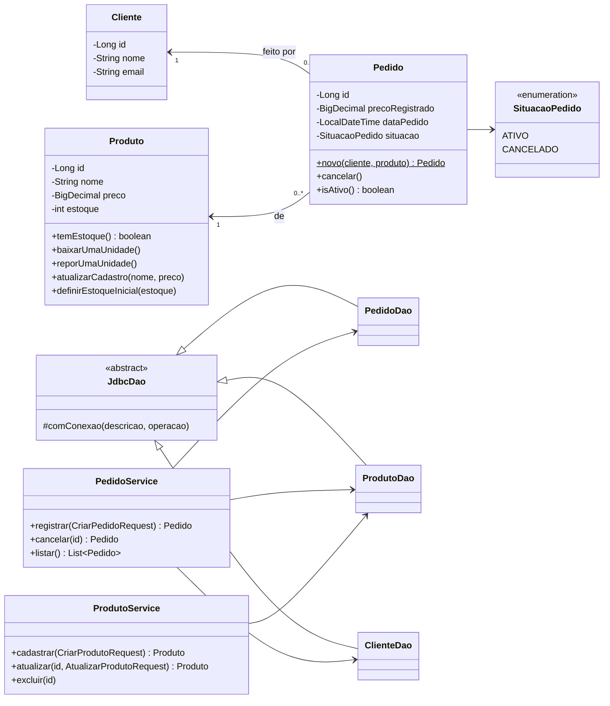

<div align="center">

# 🍔 Cantina API

**Sistema de Pedidos de Cantina — API REST em Java**

*AVC 2026/2 · Técnicas de Programação · Engenharia de Software 6A · Profª Ingrid Batista*


</div>

---

## 📌 Sumário

- [🎯 Sobre o projeto](#-sobre-o-projeto)
- [👥 Integrantes](#-integrantes)
- [🚀 Como executar](#-como-executar)
- [🛣️ Rotas da API](#️-rotas-da-api)
- [📏 Regras de negócio](#-regras-de-negócio)
- [🏗️ Arquitetura](#️-arquitetura)
- [🧩 Diagrama de classes (UML)](#-diagrama-de-classes-uml)
- [🧠 Decisões técnicas](#-decisões-técnicas)
- [🔎 Algoritmos: busca e ordenação](#-algoritmos-busca-e-ordenação)
- [🧪 Testes e evidências](#-testes-e-evidências)
- [♻️ Refatoração registrada](#️-refatoração-registrada)
- [🤖 Declaração de uso de IA](#-declaração-de-uso-de-ia)
- [🗺️ Status da versão beta](#️-status-da-versão-beta)

---

## 🎯 Sobre o projeto

Uma cantina precisa **registrar pedidos** e **controlar o estoque** dos produtos. Para manter o escopo do tema, **cada pedido tem um único produto e uma única unidade**: não existe carrinho nem tabela de itens.

| Entidade | O que guarda |
|---|---|
| 👤 **Cliente** | id, nome, e-mail único *(vem do banco; somente consulta)* |
| 🥪 **Produto** | id, nome, preço, estoque disponível |
| 🧾 **Pedido** | id, cliente, produto, **preço registrado**, data, situação (`ATIVO` / `CANCELADO`) |

> 💡 **A ideia central:** quando um pedido é feito, o preço do produto é **copiado** para o pedido. Se o preço mudar depois, o histórico continua mostrando o valor pago na época.

---

## 👥 Integrantes

| Nº | RA | Nome completo | Contribuição principal |
|:-:|---|---|---|
| 1 | `______` | Daniel Sammartano | _a preencher_ |
| 2 | `______` | _a preencher_ | _a preencher_ |
| 3 | `______` | _a preencher_ | _a preencher_ |
| 4 | `______` | _a preencher_ | _a preencher_ |

> ⚠️ Só recebe nota quem estiver nesta lista e na entrega do Teams.

---

## 🚀 Como executar

### ✅ Pré-requisitos

- ☕ **Java 21** e 📦 **Maven 3.9+**
- 🐘 **PostgreSQL** com o banco do tema

### 1️⃣ Configure as credenciais (nunca ficam no código)

```bash
cp .env.example .env
# edite o .env com a URL, o usuário e a senha do seu PostgreSQL
```

| Variável | Exemplo |
|---|---|
| `DB_URL` | `jdbc:postgresql://localhost:5433/cantina` |
| `DB_USER` | `cantina` |
| `DB_PASSWORD` | `********` |

> 🔒 O arquivo `.env` está no `.gitignore`. A aplicação também lê essas variáveis direto do ambiente do sistema.

### 2️⃣ Suba o banco

**Opção A: banco oficial da disciplina.** Restaure o dump fornecido pela professora e aponte o `DB_URL` para ele.

**Opção B: banco provisório local (opcional, via Docker).**

```bash
docker compose up -d     # cria o banco com db/01-schema.sql e db/02-seed.sql
```

> 🐳 O Docker **não** é requisito da AVC; é só uma conveniência para quem não quer instalar o PostgreSQL.

### 3️⃣ Rode a API

```bash
mvn spring-boot:run
# 🌐 a API sobe em http://localhost:8080
```

### 4️⃣ Rode os testes

```bash
mvn test                 # 🧪 testes JUnit (não precisam de banco)
```

Para a coleção do Postman: importe `postman/cantina-api.postman_collection.json` e execute na ordem (**Runner**), com o banco recém-criado.

---

## 🛣️ Rotas da API

| Método | Rota | O que faz | Sucesso |
|:-:|---|---|:-:|
| 🟢 `GET` | `/clientes` | Lista clientes | `200` |
| 🟢 `GET` | `/clientes/{id}` | Consulta um cliente | `200` |
| 🟡 `POST` | `/produtos` | Cadastra produto | `201` |
| 🟢 `GET` | `/produtos` | Lista produtos | `200` |
| 🟢 `GET` | `/produtos/{id}` | Consulta produto | `200` |
| 🔵 `PUT` | `/produtos/{id}` | Atualiza nome e preço *(estoque só sem histórico)* | `200` |
| 🔴 `DELETE` | `/produtos/{id}` | Exclui **somente se não houver pedidos** | `204` |
| 🟡 `POST` | `/pedidos` | Registra pedido e **baixa 1 unidade** do estoque | `201` |
| 🟢 `GET` | `/pedidos` | Lista o histórico de pedidos | `200` |
| 🟣 `PATCH` | `/pedidos/{id}/cancelamento` | Cancela e **devolve 1 unidade** ao estoque | `200` |

### 📨 Exemplos

<details>
<summary><b>➕ Cadastrar produto</b></summary>

```http
POST /produtos
Content-Type: application/json

{ "nome": "Pastel de queijo", "preco": 8.50, "estoque": 3 }
```

```json
{ "id": 6, "nome": "Pastel de queijo", "preco": 8.50, "estoque": 3 }
```
</details>

<details>
<summary><b>🧾 Registrar pedido</b></summary>

```http
POST /pedidos
Content-Type: application/json

{ "clienteId": 1, "produtoId": 6 }
```

```json
{
  "id": 1,
  "clienteId": 1,
  "clienteNome": "Ana Souza",
  "produtoId": 6,
  "produtoNome": "Pastel de queijo",
  "precoRegistrado": 8.50,
  "dataPedido": "2026-10-09T11:41:00",
  "situacao": "ATIVO"
}
```
</details>

<details>
<summary><b>❌ Formato padrão de erro</b></summary>

```json
{
  "timestamp": "2026-10-09T11:41:56",
  "status": 409,
  "erro": "Conflict",
  "mensagem": "Pedido 1 ja esta cancelado",
  "caminho": "/pedidos/1/cancelamento"
}
```
</details>

### 🚦 Códigos de status

| Código | Quando acontece |
|:-:|---|
| `400` 🟠 | Dados inválidos: campo obrigatório vazio, preço ≤ 0, estoque negativo, JSON malformado, ID não numérico |
| `404` 🔍 | Referência inexistente: cliente, produto ou pedido não encontrado |
| `409` ⛔ | Regra de negócio, duplicidade ou estado impossível: sem estoque, cancelamento repetido, exclusão/alteração de estoque com histórico |
| `503` 🔌 | Banco de dados indisponível |

---

## 📏 Regras de negócio

| # | Regra | Onde é garantida |
|:-:|---|---|
| 1 | Cliente e produto precisam existir | `PedidoService` → `404` |
| 2 | Produto precisa ter estoque positivo | `Produto.baixarUmaUnidade()` → `409` |
| 3 | Estoque **nunca** fica negativo | Domínio **+** `CHECK (estoque >= 0)` no banco |
| 4 | Preço é **copiado** para o pedido | `Pedido.novo()` (coluna `preco_registrado`) |
| 5 | Pedido cancelado não pode ser cancelado de novo | `Pedido.cancelar()` → `409` |
| 6 | Pedido + baixa de estoque na **mesma transação** | `@Transactional` em `PedidoService.registrar()` |
| 7 | Cancelamento + reposição na **mesma transação** | `@Transactional` em `PedidoService.cancelar()` |
| 8 | Com histórico, estoque só muda por pedido/cancelamento | `ProdutoService.atualizar()` → `409` |
| 9 | Produto com histórico não pode ser excluído | `ProdutoService.excluir()` → `409` **+** `ON DELETE RESTRICT` |

### ✅ Cenários de aceitação do enunciado

| Cenário | Resultado | Coberto por |
|---|---|---|
| 🥪 Pedir produto com estoque | Cria pedido, registra preço e baixa 1 unidade | JUnit + Postman 09/10 |
| 🚫 Pedir produto sem estoque | Rejeita sem registrar pedido | JUnit + Postman 15 |
| 👻 Informar cliente inexistente | Rejeita sem alterar o estoque | JUnit + Postman 13/14 |
| 💲 Alterar preço após um pedido | Pedido mantém o preço histórico | JUnit + Postman 11/12 |
| 🔁 Cancelar e repetir cancelamento | Repõe 1 unidade só na primeira chamada | JUnit + Postman 16/17/18 |

---

## 🏗️ Arquitetura

```
📮 Postman / HTTP
      │
      ▼
🎮 Controller     → recebe a requisição, valida o formato (@Valid) e devolve o status HTTP
      │
      ▼
🧠 Service        → regras de negócio e transações (@Transactional)
      │
      ▼
🗄️ DAO (JDBC)     → SQL com PreparedStatement; nenhuma regra de negócio
      │
      ▼
🐘 PostgreSQL
```

```
src/main/java/br/com/cantina
├── 🎮 controller/   ClienteController · ProdutoController · PedidoController · TratadorDeErros
├── 🧠 service/      ClienteService · ProdutoService · PedidoService
├── 🗄️ dao/          JdbcDao (base) · ClienteDao · ProdutoDao · PedidoDao
├── 🧱 dominio/      Cliente · Produto · Pedido · SituacaoPedido
├── 📦 dto/          requests e responses (records)
├── ⚠️ excecao/      RegraNegocioException · RecursoNaoEncontradoException · PersistenciaException
└── 🔎 algoritmos/   BuscaProduto · OrdenacaoProduto · GeradorProdutos   (fora das rotas)
```

---

## 🧩 Diagrama de classes (UML)



---

## 🧠 Decisões técnicas

| 🧩 Decisão | 🤔 Por quê |
|---|---|
| **JDBC puro + `PreparedStatement`** | Exigência da AVC. Toda consulta é parametrizada (sem SQL injection) e todo `PreparedStatement`/`ResultSet` fica em *try-with-resources*. Sem JPA/Hibernate. |
| **`@Transactional` + `DataSourceUtils`** | Os DAOs pegam a conexão por `DataSourceUtils`, que devolve **a mesma conexão** enquanto a transação do Service está aberta. Se qualquer etapa falhar, o rollback desfaz tudo e nada fica pela metade. |
| **`SELECT ... FOR UPDATE`** | Trava a linha do produto e a do pedido durante a operação. Evita que dois pedidos simultâneos vendam a **última unidade** duas vezes, ou que dois cancelamentos simultâneos reponham estoque em dobro. |
| **Regras no domínio** | `Produto.baixarUmaUnidade()` e `Pedido.cancelar()` protegem o próprio estado (encapsulamento). O Service orquestra e o DAO só executa SQL. |
| **Defesa em profundidade no banco** | `CHECK (estoque >= 0)`, `CHECK situacao IN (...)` e `ON DELETE RESTRICT`: mesmo um bug no código não corrompe os dados. |
| **`preco_registrado` no pedido** | Copiar o preço é o que mantém o histórico imutável quando o cadastro muda. |
| **Exceções → HTTP num só lugar** | `TratadorDeErros` (`@RestControllerAdvice`) traduz cada exceção para 400/404/409/503 com um JSON padrão. Os controllers ficam limpos. |
| **Credenciais fora do código** | `application.properties` usa `${DB_URL}`, `${DB_USER}` e `${DB_PASSWORD}`, lidos de `.env` (ignorado pelo Git) ou do ambiente. |
| **Sem interfaces "por obrigação"** | O enunciado não pede interfaces nem padrões extras. Os DAOs são classes concretas; o Mockito consegue simulá-las nos testes. |
| **`BigDecimal` para dinheiro** | `double` causa erros de arredondamento (ex.: `0.1 + 0.2 ≠ 0.3`). |

---

## 🔎 Algoritmos: busca e ordenação

📁 Pacote `br.com.cantina.algoritmos`: independente das rotas. Trabalha com uma **coleção em memória de produtos** gerada de forma reproduzível (`GeradorProdutos.gerar(50, 42L)`: mesma semente, mesma lista).

| Algoritmo | Classe | Tempo | Memória extra | Observação |
|---|---|:-:|:-:|---|
| 🐢 **Busca linear** por ID | `BuscaProduto.linearPorId` | **O(n)** | O(1) | Funciona em lista desordenada |
| 🐇 **Busca binária** por ID | `BuscaProduto.binariaPorId` | **O(log n)** | O(1) | ⚠️ Exige lista **ordenada por ID** |
| 🔀 **Merge Sort** por preço ou ID | `OrdenacaoProduto.mergeSort` | **O(n log n)** | O(n) | Estável; não altera a lista original |

### 🤓 Por que a busca binária precisa da lista ordenada pela **mesma chave**?

A cada passo ela olha o elemento do meio e decide: *"o ID que procuro é maior, então descarto a metade esquerda"*. Esse raciocínio só vale se os IDs estiverem em ordem crescente. Se a lista estiver ordenada por **preço**, um ID maior pode estar à esquerda, e a busca descarta justamente a metade onde ele está. Por isso o teste primeiro ordena por ID (`OrdenacaoProduto.POR_ID`) e só depois faz a busca binária.

### 📊 Comparação rápida (n = 1.000 produtos)

| | Comparações no pior caso |
|---|:-:|
| Busca linear | ~1.000 |
| Busca binária | ~10 (log₂ 1000) |
| Merge Sort | ~10.000 (n·log₂ n) |

> 💡 **Conclusão:** para uma única busca, a linear basta. Para **muitas** buscas na mesma coleção, compensa ordenar uma vez (O(n log n)) e depois fazer várias buscas binárias (O(log n) cada).

---

## 🧪 Testes e evidências

### ☕ JUnit: `mvn test`: **14 testes, 0 falhas** ✅

| Classe | O que valida |
|---|---|
| `PedidoServiceTest` 🧠 | Pedido com estoque · sem estoque · cliente inexistente · preço histórico · cancelar duas vezes |
| `ProdutoServiceTest` 🧠 | Estoque bloqueado com histórico · exclusão bloqueada · produto inexistente |
| `ProdutoTest` 🧱 | **Fronteira:** baixar a última unidade (1 → 0) e rejeitar a próxima; estoque negativo |
| `AlgoritmosProdutoTest` 🔎 | Linear = binária · ID inexistente · lista vazia · ordenação por preço · estabilidade |

Os testes de Service usam **Mockito** para simular os DAOs, então rodam sem banco.

📄 Saída completa: [`docs/evidencias/junit-mvn-test.txt`](docs/evidencias/junit-mvn-test.txt)

### 📮 Postman: **23 requisições · 34 asserções · 0 falhas** ✅

📄 Coleção: [`postman/cantina-api.postman_collection.json`](postman/cantina-api.postman_collection.json)
📄 Execução (Newman): [`docs/evidencias/postman-newman.txt`](docs/evidencias/postman-newman.txt)

#### ⭐ Cenários próprios do grupo

| Cenário | Esperado | 🤔 Por que é relevante |
|---|:-:|---|
| **19** · Excluir produto que já tem pedidos | `409` | Prova que o histórico **não pode ser destruído**: sem essa regra, o `DELETE` apagaria os pedidos ou quebraria a integridade. |
| **20** · Alterar o estoque pelo `PUT` de um produto com histórico | `409` | Garante que o estoque só muda pelas operações previstas. Se fosse possível "editar" o estoque, a contagem deixaria de bater com os pedidos registrados. |

> ⚠️ Esta é a coleção **do grupo**. Quando a **coleção oficial** for disponibilizada, ela deve ser executada **sem alterar os resultados esperados** e a evidência deve ser adicionada aqui.

---

## ♻️ Refatoração registrada

> ✍️ **A preencher pelo grupo** com uma melhoria real feita durante o desenvolvimento.

| | |
|---|---|
| 🐞 **Problema encontrado** | _ex.: cada DAO repetia o mesmo bloco de abrir conexão, tratar `SQLException` e liberar a conexão_ |
| 🔧 **Alteração feita** | _ex.: extração da classe base `JdbcDao` com o método `comConexao(...)`_ |
| ✅ **Teste que validou** | _ex.: `PedidoServiceTest` e a coleção do Postman continuaram passando, sem mudança de comportamento_ |

---

## 🤖 Declaração de uso de IA

Conforme a orientação nº 7 do enunciado, declaramos que usamos ferramentas de IA como apoio:

| Ferramenta | Uso |
|---|---|
| **Claude (Anthropic) via Claude Code** | Estrutura inicial do projeto (versão beta): camadas, DAOs JDBC, regras do Service, testes JUnit, coleção do Postman e este README |

✅ **Todo o código foi lido, compreendido, executado e testado pelo grupo.** Cada integrante consegue explicar as regras de negócio, os testes e as decisões apresentadas acima.

> ✍️ _Grupo: revisem e complementem esta seção com o que cada um fez de fato._

---

## 🗺️ Status da versão beta

- [x] 🛣️ Todas as 10 rotas do contrato mínimo
- [x] 🔐 Transação no pedido e no cancelamento, com trava de concorrência
- [x] 🚦 Erros 400 / 404 / 409 / 503 com JSON padronizado
- [x] 🔎 Busca linear, busca binária e Merge Sort, com testes
- [x] 🧪 14 testes JUnit + coleção do Postman com cenários próprios
- [x] 🧩 UML coerente com o código
- [ ] 🐘 Trocar o banco provisório (`db/`) pelo **banco oficial** da professora e ajustar os nomes no SQL dos DAOs, se necessário
- [ ] 📮 Executar a **coleção oficial do Postman** e anexar a evidência
- [ ] 👥 Preencher integrantes, RA e contribuições
- [ ] ♻️ Registrar a refatoração real do grupo
- [ ] 🎥 Gravar o vídeo de defesa (máx. 5 min; todos participam)

📅 **Entrega:** 03/11/2026 via Teams.

---

<div align="center">

Feito com ☕ e 🥪 para a AVC de Técnicas de Programação

</div>
